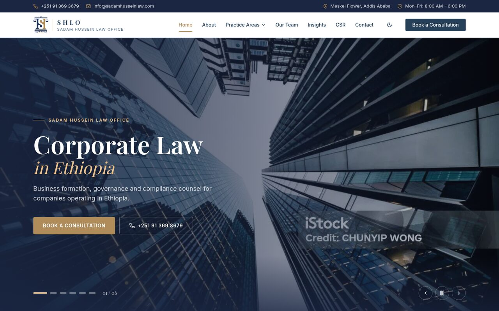
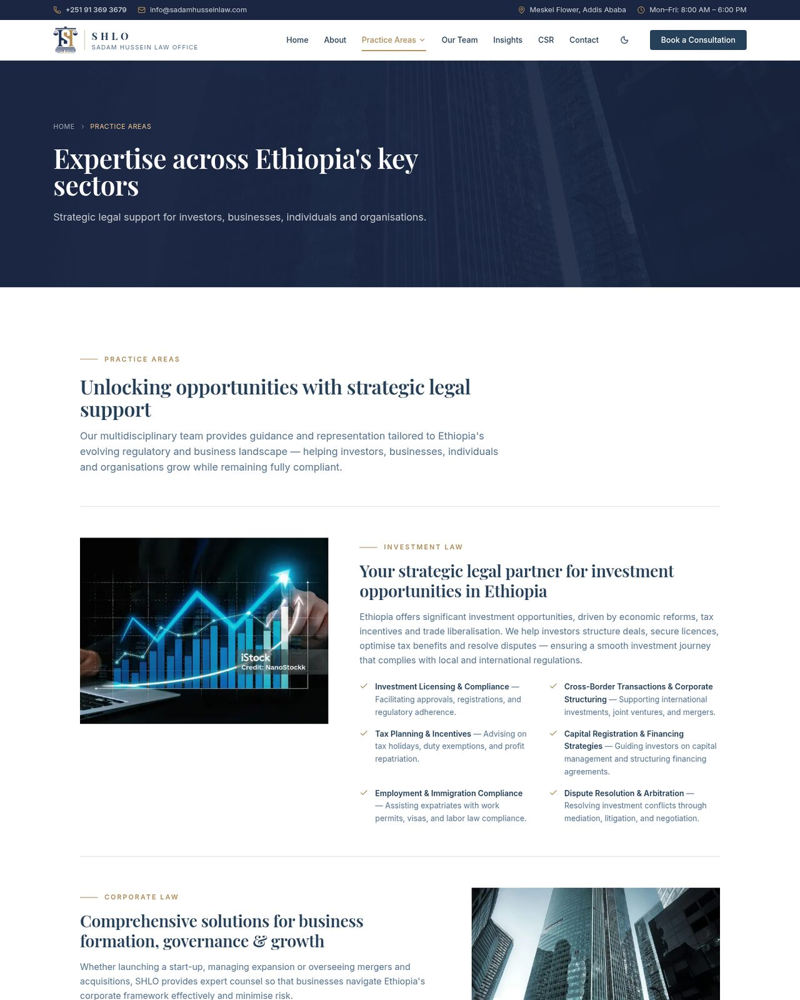
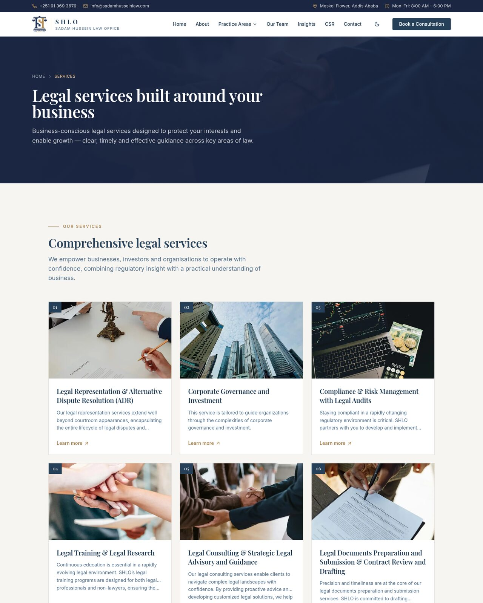
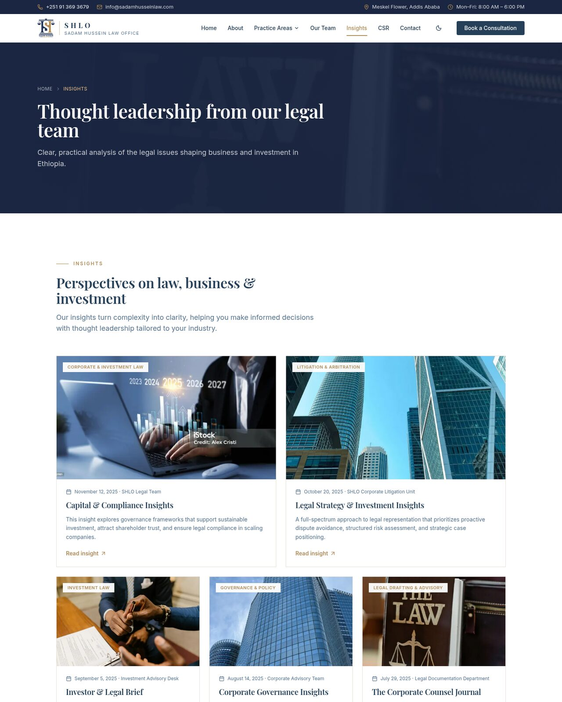
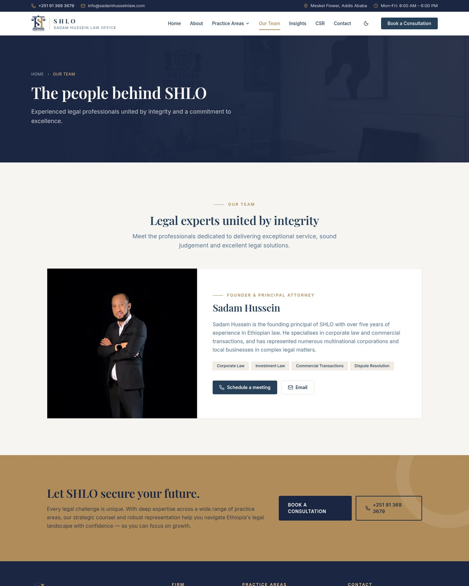
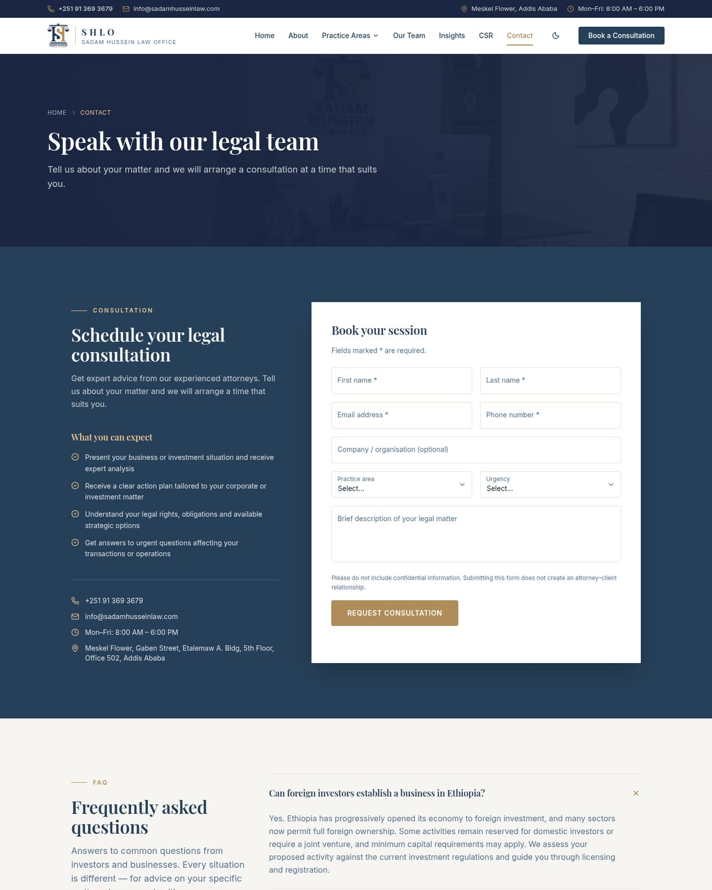

<div align="center">


# Sadam Hussein Law Office (SHLO)

**The official website of a full-service Ethiopian law firm advising investors, corporations, start-ups and institutions.**

[](https://nextjs.org)
[](https://react.dev)
[](https://www.typescriptlang.org)
[](https://tailwindcss.com)
[](https://vercel.com)



</div>

---

## Overview

SHLO's website presents the firm's practice areas, services, team and thought leadership to clients doing business in Ethiopia, and gives them a straightforward way to book a consultation. It is built with the Next.js App Router, statically pre-rendered for speed, and styled with a navy-and-gold design system that works in both light and dark mode.

## Features

- **Hero slider** — auto-playing, pausable carousel highlighting the firm's core practices
- **Practice areas** — 16 statically generated detail pages (investment, corporate, tax & customs, M&A, real estate and more)
- **Services** — six service offerings, each with its own detail page
- **Insights & News** — articles and firm updates with dynamic `[slug]` routes
- **CSR** — the firm's corporate social responsibility initiatives
- **Team profiles** — founder and attorney bios with direct contact actions
- **Consultation booking** — structured intake form with practice area and urgency
- **FAQ** — accessible accordion answering common investor questions
- **Light / dark theme** — powered by `next-themes`
- **Responsive** — mobile-first layout with a slide-out navigation sheet
- **SEO-ready** — per-page metadata, Open Graph tags and static generation

## Screenshots

| Practice Areas | Services |
| :---: | :---: |
|  |  |
| **Insights** | **Our Team** |
|  |  |

<table>
  <tr>
    <th>Contact &amp; Consultation</th>
    <th>Mobile</th>
  </tr>
  <tr>
    <td></td>
    <td align="center"></td>
  </tr>
</table>

## Tech Stack

| Layer | Tools |
| --- | --- |
| Framework | [Next.js 15](https://nextjs.org) (App Router, Turbopack dev server) |
| UI | [React 19](https://react.dev), [Radix UI](https://www.radix-ui.com) primitives, [shadcn/ui](https://ui.shadcn.com)-style components |
| Styling | [Tailwind CSS 3](https://tailwindcss.com), `tailwindcss-animate`, `@tailwindcss/typography` |
| Icons | [Lucide](https://lucide.dev) |
| Fonts | Inter & Playfair Display via `next/font` |
| Theming | [`next-themes`](https://github.com/pacocoursey/next-themes) |
| Language | TypeScript |
| Hosting | [Vercel](https://vercel.com) |

## Getting Started

### Prerequisites

- **Node.js** 18.18 or later (20+ recommended)
- **pnpm** (the project's declared package manager) — `npm` also works

### Installation

```bash
git clone https://github.com/Jennah198/law-firm-website.git
cd law-firm-website
pnpm install
```

### Development

```bash
pnpm dev
```

Open [http://localhost:3000](http://localhost:3000) in your browser. Pages hot-reload as you edit.

### Scripts

| Command | Description |
| --- | --- |
| `pnpm dev` | Start the development server with Turbopack |
| `pnpm build` | Create an optimized production build |
| `pnpm start` | Serve the production build |
| `pnpm lint` | Run ESLint |

## Project Structure

```
law-firm-website/
├── public/                  # Static assets: logos, hero slides, practice & service imagery
├── docs/screenshots/        # Images used in this README
└── src/
    ├── app/                 # App Router pages and layouts
    │   ├── practice-areas/  #   └── [slug] detail pages
    │   ├── services/        #   └── [slug] detail pages
    │   ├── insights/        #   └── [slug] detail pages
    │   ├── news-and-updates/#   └── [slug] detail pages
    │   ├── about/  contact/  csr/  teams/  who-we-are/
    │   └── layout.tsx       # Root layout: fonts, theme, header, footer
    ├── components/          # Shared layout components (navigation, footer, page header)
    │   └── ui/              # Reusable UI primitives (button, card, sheet, …)
    ├── features/sections/   # Page sections (hero slider, services, FAQ, contact, …)
    ├── lib/                 # Content data and helpers (services, insights, news, CSR)
    ├── constants/           # Site-wide constants
    └── types/               # Shared TypeScript types
```

## Editing Content

Most site content lives in plain TypeScript data files, so updates don't require touching components:

| Content | File |
| --- | --- |
| Services | `src/lib/services-data.ts` |
| Insights | `src/lib/insights.ts` |
| News & updates | `src/lib/new-and-updates.ts` |
| CSR initiatives | `src/lib/csr.ts` |
| Practice area pages | `src/app/practice-areas/[slug]/page.tsx` |
| Shared site data | `src/constants/data.ts` |
| Hero slides | `src/features/sections/hero-slider.tsx` |

Images referenced by these files live in `public/`.

## Deployment

The site is deployed on **Vercel**. Pushing to the production branch triggers a new deployment automatically. To deploy manually:

```bash
pnpm build      # verify the build locally
npx vercel --prod
```

## Contact

**Sadam Hussein Law Office**
Meskel Flower, Gaben Street, Etalemaw A. Bldg, 5th Floor, Office 502, Addis Ababa, Ethiopia
📞 +251 91 369 3679 · ✉️ [info@sadamhusseinlaw.com](mailto:info@sadamhusseinlaw.com)
🕗 Mon–Fri, 8:00 AM – 6:00 PM

---

<div align="center">
<sub>© Sadam Hussein Law Office. All rights reserved.</sub>
</div>
